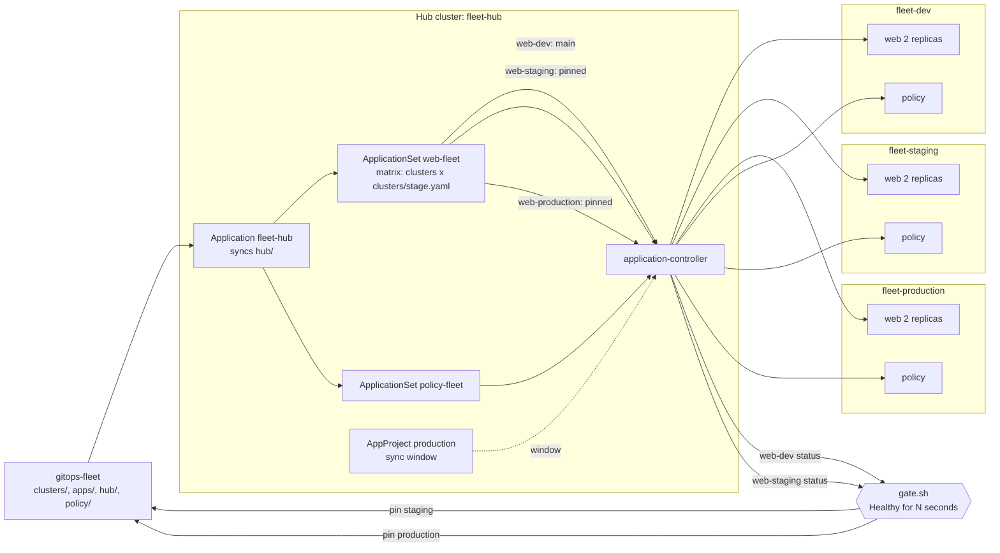

# Architecture: a fleet in waves with a health gate

This document describes what is in this repository and why it is shaped this way. Component names match the diagram in the lesson ("A fleet in waves with a health gate"): **gitops-fleet**, **ApplicationSet**, and the clusters **dev**, **staging** and **production**, plus the **admission policy** each cluster carries.

## Components and what each owns

| Component | Where it lives | What it owns |
| --- | --- | --- |
| **gitops-fleet** | the working clone `.work/gitops-fleet`, seeded from [`manifests/`](manifests), served by the hub's Git server | The whole fleet as files: `clusters/<stage>.yaml` (the revision, prune and observation time of each stage), `apps/web/base` (the app), `hub/` (the ApplicationSets and the projects) and `policy/`. |
| **Hub** (cluster `fleet-hub`) | [`scripts/cluster-up.sh hub`](scripts/cluster-up.sh) | Argo CD v3.5.6, the Git server, nothing else. The only place a controller runs. [ADR 0001](docs/adr/0001-one-hub-and-three-workload-clusters.md). |
| **ApplicationSet web-fleet** | [`manifests/hub/appset-web.yaml`](manifests/hub/appset-web.yaml) | A matrix of the cluster generator (every registered cluster labelled `app=web`) and a Git file generator (`clusters/<stage>.yaml`, read for the cluster's `stage` label). It produces one `Application` per cluster; its template patch sets `selfHeal: true` everywhere and `prune` from the stage's file. |
| **ApplicationSet policy-fleet** | [`manifests/hub/appset-policy.yaml`](manifests/hub/appset-policy.yaml) | The same cluster selector, one `policy-<cluster>` Application per cluster, all pointing at `policy/` on `main`. |
| **AppProjects** | [`manifests/hub/projects.yaml`](manifests/hub/projects.yaml) | `dev`, `staging`, `production` (the last with the sync window) and `fleet-policy`. Each allows one repository and the namespaces and cluster-scoped kinds its Applications need. |
| **Root Application** | [`platform/root-application.yaml`](platform/root-application.yaml) | The one object applied by hand; it syncs `hub/` from Git, so the generators and projects are changed by commits. |
| **dev, staging, production** (clusters) | `fleet-dev`, `fleet-staging`, `fleet-production`; registered by [`register-cluster.sh`](scripts/register-cluster.sh) | Only the workload (`web` namespace) and the admission policy. Each publishes its app on a host port for the traffic test. |
| **Admission policy** | [`manifests/policy/no-privileged.yaml`](manifests/policy/no-privileged.yaml) | A `ValidatingAdmissionPolicy` and its binding: privileged containers and images outside `plainround/` are refused for Deployments and Pods, in every namespace except the system ones. [ADR 0003](docs/adr/0003-native-admission-policy.md). |
| **Health gate** | [`scripts/gate.sh`](scripts/gate.sh) | Reads the `web-<stage>` Application status on the hub (health, sync revision, last operation), not the workload clusters. Succeeds when a stage applied a commit and stayed Healthy for its `observeSeconds`; fails at once when the stage turns Degraded or its sync is refused. |
| **Waves** | [`scripts/promote.sh`](scripts/promote.sh) | Gate dev, pin staging, gate staging, pin production. Each pin is a commit to `clusters/<stage>.yaml`. [ADR 0002](docs/adr/0002-waves-by-pinned-revisions.md). |
| **Sync window** | the `production` AppProject, moved by [`runbook/window.sh`](scripts/runbook/window.sh) | Production may sync only inside a one-hour window; outside it a pinned commit waits as `OutOfSync`. |
| **Protections** | `Prune=false` on the Namespace, `prune: false` in `clusters/production.yaml` | A commit that deletes the namespace's manifest deletes nothing. [ADR 0004](docs/adr/0004-protections-against-a-destructive-commit.md). |
| **Tests** | [`tests/`](tests) | Offline: file shape, generators, projects, policy, the best-case arithmetic. Cluster: one module per lesson step against the running fleet. |

## Pattern: a pull-based fleet with revisions as the unit of rollout

Every cluster pulls from the hub's controller; no cluster holds credentials for any other. The unit of rollout is a *revision*: dev follows `main`; staging and production are pinned to a commit, and moving a pin is a commit. So the order of waves, who allowed each, and when, are in the repository's history, and every Application keeps `selfHeal: true`, which a manual-sync design would give up.

## Data flow

Drawn versions of this figure and of the walk-through: [the architecture](docs/diagrams/architecture.svg) and [one run](docs/diagrams/flow.svg).

### One wave, step by step (`scripts/runbook/03-waves.sh good`)

1. A commit changes `apps/web/base/deployment.yaml` (web 1.1.0) and is pushed to `main`. The pre-push hook runs `validate.sh`.
2. The hub polls Git every 20 seconds. `web-dev` tracks `main`, so it syncs the new revision into `fleet-dev`.
3. `promote.sh` runs `gate.sh dev <commit>`: the sync operation succeeded at that commit (or a descendant) and the app is Healthy. It then observes for dev's `observeSeconds` (30 here); any moment that is not Healthy closes the gate.
4. `promote.sh` commits `revision: <commit>` to `clusters/staging.yaml` and pushes. Within 20 seconds the ApplicationSet's Git generator re-reads the file, changes `web-staging`'s `targetRevision`, and the controller syncs `fleet-staging`. `gate.sh staging` observes for 45 seconds.
5. `promote.sh` commits the pin for production. The `web-production` Application changes its target at once, but the production project's window is closed (twelve hours away in the test), so the app is `OutOfSync` and the cluster still runs 1.0.0.
6. `03-waves.sh open` moves the window to the current hour by a commit to `hub/projects.yaml`; the root Application syncs it, the window opens, and production applies the pinned commit.

A change that fails its health check in dev closes the first gate: `promote.sh` stops, staging and production are never pinned to it, and the rest of the fleet keeps its last good commit.

## Decisions and trade-offs

**A hub cluster.** One controller, many clusters, and a controller to lose without touching the workload clusters. The cost is a fourth cluster and a registration step. [ADR 0001](docs/adr/0001-one-hub-and-three-workload-clusters.md).

**Waves are pinned revisions.** Keeps self-heal everywhere and puts the order of promotion in Git; costs one extra requeue of the ApplicationSet per wave, which `scripts/best-case.sh` includes. [ADR 0002](docs/adr/0002-waves-by-pinned-revisions.md).

**The gate looks at health and the last operation, not at `Synced`.** A protected deletion leaves a stage `OutOfSync` on purpose; the wave must still be able to judge it.

**Native admission policy.** No webhook, no pods, and the same decision in every cluster. Kyverno remains the answer when the policy has to mutate or verify signatures. [ADR 0003](docs/adr/0003-native-admission-policy.md).

**Two layers against a destructive commit.** Production does not prune, and the Namespace is never pruned in any stage. [ADR 0004](docs/adr/0004-protections-against-a-destructive-commit.md).

**Traffic through a host port.** The outage experiment must not route through the thing it stops. [ADR 0005](docs/adr/0005-traffic-through-a-host-port.md).

**The window is a calendar rule in an AppProject.** Moving it is a commit; the tests move it to "now" and to "twelve hours away" instead of waiting for 22:00 UTC.

**`observeSeconds` are 30 and 45, not 300 and 600.** A scripted run cannot wait fifteen minutes per change; `best-case.sh --lesson` prints the arithmetic with the lesson's windows.

## Failure modes the lesson teaches, and how the code shows them

| Failure | What you see | How to reproduce |
| --- | --- | --- |
| **Hand-written Application per cluster** | A cluster missing from the repository's list gets no app; adding one is a new manifest | not present on purpose; `02-generate-apps.sh add` shows the generator doing it |
| **A change that fails health in dev** | Dev is Degraded, the gate closes, staging and production keep their pins | `scripts/runbook/03-waves.sh bad` |
| **A healthy change at the wrong time** | Production is `OutOfSync` and unchanged until the window opens | `window.sh closed`, then `03-waves.sh good` |
| **A privileged pod in a commit** | The sync fails in every cluster with the policy's message | `scripts/runbook/04-policy.sh privileged` |
| **A foreign image in a commit** | The same, with the registry message | `04-policy.sh foreign` |
| **A commit that deletes the namespace manifest** | Nothing is deleted; the stage is `OutOfSync` with the namespace needing pruning | `scripts/runbook/05-destructive-commit.sh commit` |
| **The controller is down** | The app keeps serving, drift made meanwhile stays, and is corrected when the controller returns | `scripts/runbook/06-controller-outage.sh` |
| **Policy installed in one cluster only** | Not possible: the policy Application is generated from the same selector | compare the two ApplicationSets |

## Limits of the teaching build against production

- **Four clusters on one machine.** Real clusters are separate failure domains; here a Docker VM is the shared fate.
- **The hub's token is `cluster-admin` in each cluster** (what `argocd cluster add` grants). Production scopes it.
- **No authentication on the Git server**, loopback only.
- **The gate is a script a person runs.** A production fleet runs it in CI or in a promotion controller, with metrics from the app (error rate, latency) beside Kubernetes health.
- **Time is compressed:** 30 and 45 seconds of observation, a 20-second poll, and an outage of 90 seconds in the tests (1,800 on request).
- **One app.** A fleet has many; the generators scale, the gate would need one per app or a shared one.

## How to extend it

- **Another stage or cluster:** `scripts/register-cluster.sh <name> <stage>`; no manifest changes.
- **Per-cluster values:** add keys to `clusters/<stage>.yaml` and use them in the template through the matrix's parameters (the third stretch goal).
- **Signed commits:** have the controller verify GPG signatures on the repository (a project setting) before syncing.
- **Progressive rollout inside production:** add an Argo Rollouts `Rollout` with an analysis template to `apps/web/base`.
- **Kyverno:** replace `policy/` with `ClusterPolicy` objects and add Kyverno to the policy Applications.
